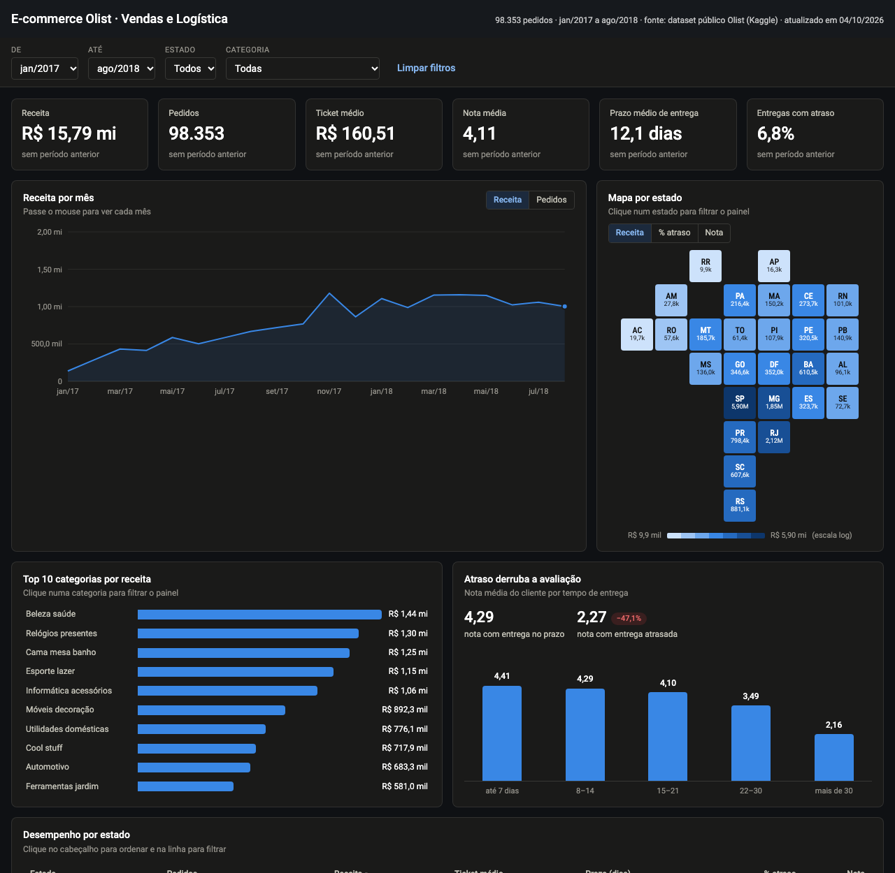
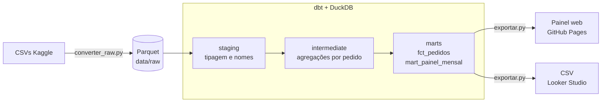

# E-commerce Olist · Vendas e Logística

[](https://github.com/gelucass/portfolio-olist/actions/workflows/pipeline.yml)

Pipeline de dados completo, do CSV bruto ao painel publicado, com 98.353 pedidos da Olist (jan/2017 a ago/2018).

**[Abrir o painel](https://gelucass.github.io/portfolio-olist/)** · **[Documentação dos modelos (dbt docs)](https://gelucass.github.io/portfolio-olist/docs/)** · **[English summary](#english-summary)**

Feito por **George Lucas**, Analytics Engineer · [LinkedIn](https://www.linkedin.com/in/george-lucas-274ba1104/) · [GitHub](https://github.com/gelucass)

[](https://gelucass.github.io/portfolio-olist/)

## Principais achados
- **R$ 15,8 mi** em receita, ticket médio de **R$ 160,51**.
- **SP** concentra 37% da receita, seguido de RJ e MG.
- **6,8%** das entregas chegam depois da data prometida.
- **Atraso derruba a avaliação:** nota média de **4,29** com entrega no prazo e **2,27** com atraso.

## Arquitetura



A cada push na `main`, o GitHub Actions roda `dbt build` (modelos + 36 testes), gera a documentação e publica o painel. **Se algum teste falha, o painel não é atualizado.**

| Camada | Modelos | Papel |
|---|---|---|
| staging | `stg_olist__*` | Tipagem (a origem chega toda como texto) e nomes em português |
| intermediate | `int_itens_agregados_por_pedido`, `int_categoria_principal_por_pedido`, `int_avaliacoes_por_pedido` | Leva tudo para o grão de pedido antes dos joins |
| marts | `fct_pedidos` | 1 linha por pedido, também exportada para o Looker Studio |
| marts | `mart_painel_mensal` | Somas e contagens por mês × estado × categoria, lidas pelo painel |
| seeds | `palavras_acentuadas`, `status_pedido` | De-para mantido em CSV, versionado junto do código |

## Métricas definidas uma vez, prontas para 5 ferramentas
Os KPIs são definidos **uma vez** em [`metricas/metricas.yml`](metricas/metricas.yml), com a definição em SQL
e a tradução para cada ferramenta. O painel publicado é a versão web; para Power BI, Tableau, Metabase e
Looker Studio, cada pasta traz as medidas na linguagem da ferramenta e o roteiro para montar o mesmo painel. Um script calcula o gabarito ([`valores_esperados.md`](metricas/valores_esperados.md))
e o CI falha se o gabarito ou as medidas geradas ficarem desatualizados.

| Ferramenta | Destaque | Pacote |
|---|---|---|
| Web | dbt + CI + deploy automático | [painel](https://gelucass.github.io/portfolio-olist/) |
| Power BI | Modelo estrela, DAX, inteligência de tempo, drill-through | [`bi/powerbi`](bi/powerbi/) |
| Tableau | LOD expressions, parâmetros, ações de painel | [`bi/tableau`](bi/tableau/) |
| Metabase | SQL com filtros de campo, painel via API | [`bi/metabase`](bi/metabase/) |
| Looker Studio | Campos na fonte, comparação de período nativa | [`bi/looker-studio`](bi/looker-studio/) |

Exemplo, a mesma métrica (% de entregas com atraso) em cada linguagem:

| | Expressão |
|---|---|
| SQL | `count(*) filter (where entrega_atrasada = 'Sim') / count(*) filter (where entregue = 'Sim')` |
| DAX | `DIVIDE ( CALCULATE ( [Pedidos], pedidos[entrega_atrasada] = "Sim" ), CALCULATE ( [Pedidos], pedidos[entregue] = "Sim" ) )` |
| Tableau | `SUM(IIF([entrega_atrasada] = 'Sim', 1, 0)) / SUM(IIF([entregue] = 'Sim', 1, 0))` |
| Looker Studio | `SUM(CASE WHEN entrega_atrasada = "Sim" THEN 1 ELSE 0 END) / SUM(CASE WHEN entregue = "Sim" THEN 1 ELSE 0 END)` |

## Como uso o Claude neste projeto
O repositório traz o kit que uso com o [Claude Code](https://claude.com/claude-code) no dia a dia de dados,
em [`.claude/`](.claude/) e [`CLAUDE.md`](CLAUDE.md):

| Peça | Tipo | O que faz |
|---|---|---|
| [`traduzir-metricas-bi`](.claude/skills/traduzir-metricas-bi/SKILL.md) | Skill | Define um KPI uma vez e traduz para DAX, Tableau, Metabase e Looker, com as armadilhas de cada ferramenta documentadas em `references/` |
| [`modelo-dbt`](.claude/skills/modelo-dbt/SKILL.md) | Skill | Cria modelos no padrão do projeto: camada certa, grão declarado, testes e documentação |
| [`dados-confidenciais`](.claude/skills/dados-confidenciais/SKILL.md) | Skill | Modo de trabalho para dados de cliente: o Claude recebe só a estrutura e desenvolve sobre dados sintéticos gerados por script |
| [`revisor-dbt`](.claude/agents/revisor-dbt.md) | Agent | Revisa mudanças no dbt antes do commit: grão, joins que duplicam linhas, testes e nomes |
| [`auditor-bi`](.claude/agents/auditor-bi.md) | Agent | Investiga por que um número do Power BI/Tableau/Metabase/Looker não bate com o gabarito |
| [`proteger_dados.py`](.claude/hooks/proteger_dados.py) | Hook | Bloqueia o Claude de ler pastas sensíveis, `.env` e de rodar clientes de banco de produção, conforme [`governanca.json`](.claude/governanca.json) |

A ideia central da governança: **o Claude só vê o que passa por ele**. Em projetos com dados de cliente,
ele escreve e testa o código sobre dados sintéticos, e o código roda no ambiente da empresa.

## Decisões e trade-offs
- **DuckDB em vez de um warehouse na nuvem.** O volume (~100 mil pedidos) cabe em memória, o CI roda em segundos e o projeto não tem custo. Com o adapter dbt certo, os modelos migram para BigQuery ou Snowflake praticamente sem mudança.
- **Parquet versionado no repositório.** São 19 MB contra 120 MB de CSV. O CI fica autocontido, sem credenciais do Kaggle.
- **Agregar antes de juntar.** Itens e avaliações vão para o grão de pedido na camada intermediate. Juntar direto duplicaria a receita de pedidos com vários itens.
- **O mart do painel guarda somas, não médias.** Assim o navegador recalcula médias e percentuais corretamente ponderados para qualquer combinação de filtros.
- **Desempate determinístico.** Quando duas categorias empatam em valor no mesmo pedido (27 casos), vence a ordem alfabética. A versão anterior, em pandas, desempatava de forma arbitrária.
- **Painel em HTML/JS puro.** Sem servidor nem licença. A contrapartida é que cada gráfico novo exige código, ao contrário de uma ferramenta de BI.

## Testes
Além de `unique`, `not_null`, `accepted_values` e `relationships`:
- `assert_painel_reconcilia_com_pedidos`: o mart do painel soma exatamente o mesmo que `fct_pedidos` (pedidos, receita e atrasos).
- `assert_prazo_entrega_coerente`: prazo só existe para pedido entregue e nunca é negativo.
- `combinacao_unica`: teste genérico próprio para unicidade de chave composta.

## Rodar localmente
```bash
python -m venv .venv && source .venv/bin/activate
pip install -r requirements.txt
cd olist_dbt && dbt build --profiles-dir . && dbt docs generate --static --profiles-dir . && cd ..
python scripts/exportar.py
python -m http.server -d _site 8000   # abra http://localhost:8000
```

Os Parquet já estão no repositório. Para refazê-los a partir da origem, baixe o [dataset da Olist no Kaggle](https://www.kaggle.com/datasets/olistbr/brazilian-ecommerce), extraia os CSVs em `raw/` e rode `python scripts/converter_raw.py`.

Dados: Olist, licença CC BY-NC-SA 4.0.

## English summary
End-to-end analytics engineering project on the public Olist e-commerce dataset (98,353 orders, Jan 2017 to Aug 2018).

- **Pipeline:** raw CSV → Parquet → dbt + DuckDB (staging, intermediate, marts) with 36 tests. GitHub Actions runs `dbt build` on every push and only publishes the dashboard if every test passes.
- **Dashboard:** [interactive web dashboard](https://gelucass.github.io/portfolio-olist/) on GitHub Pages, plus [dbt docs](https://gelucass.github.io/portfolio-olist/docs/).
- **Metrics layer:** each KPI is defined once in `metricas/metricas.yml` and translated to DAX, Tableau, Metabase and Looker Studio, with a generated answer key that CI checks against.
- **Key finding:** late deliveries drop the average review score from **4.29** (on time) to **2.27** (late); 6.8% of deliveries arrive late.
- **AI tooling:** a Claude Code kit (skills, review agents and a data-protection hook) used to build and review the project.

Built by **George Lucas**, Analytics Engineer · [LinkedIn](https://www.linkedin.com/in/george-lucas-274ba1104/)
