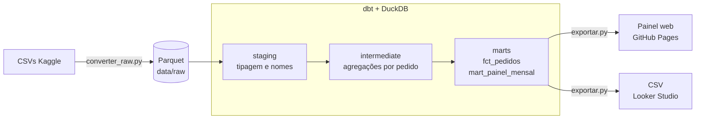

# E-commerce Olist · Vendas e Logística

[](https://github.com/gelucass/portfolio-olist/actions/workflows/pipeline.yml)

Pipeline de dados completo, do CSV bruto ao painel publicado, com 98.353 pedidos da Olist (jan/2017 a ago/2018).

**[Abrir o painel](https://gelucass.github.io/portfolio-olist/)** · **[Documentação dos modelos (dbt docs)](https://gelucass.github.io/portfolio-olist/docs/)**

## Principais achados
- **R$ 15,8 mi** em receita, ticket médio de **R$ 160,51**.
- **SP** concentra 37% da receita, seguido de RJ e MG.
- **6,8%** das entregas chegam depois da data prometida.
- **Atraso derruba a avaliação:** nota média de **4,29** com entrega no prazo e **2,27** com atraso.

## Arquitetura



A cada push na `main`, o GitHub Actions roda `dbt build` (modelos + 36 testes), gera a documentação e publica o painel. **Se algum teste falha, o painel não é atualizado.**

| Camada | Modelos | Papel |
|---|---|---|
| staging | `stg_olist__*` | Tipagem (a origem chega toda como texto) e nomes em português |
| intermediate | `int_itens_agregados_por_pedido`, `int_categoria_principal_por_pedido`, `int_avaliacoes_por_pedido` | Leva tudo para o grão de pedido antes dos joins |
| marts | `fct_pedidos` | 1 linha por pedido, também exportada para o Looker Studio |
| marts | `mart_painel_mensal` | Somas e contagens por mês × estado × categoria, lidas pelo painel |
| seeds | `palavras_acentuadas`, `status_pedido` | De-para mantido em CSV, versionado junto do código |

## Decisões e trade-offs
- **DuckDB em vez de um warehouse na nuvem.** O volume (~100 mil pedidos) cabe em memória, o CI roda em segundos e o projeto não tem custo. Com o adapter dbt certo, os modelos migram para BigQuery ou Snowflake praticamente sem mudança.
- **Parquet versionado no repositório.** São 19 MB contra 120 MB de CSV. O CI fica autocontido, sem credenciais do Kaggle.
- **Agregar antes de juntar.** Itens e avaliações vão para o grão de pedido na camada intermediate. Juntar direto duplicaria a receita de pedidos com vários itens.
- **O mart do painel guarda somas, não médias.** Assim o navegador recalcula médias e percentuais corretamente ponderados para qualquer combinação de filtros.
- **Desempate determinístico.** Quando duas categorias empatam em valor no mesmo pedido (27 casos), vence a ordem alfabética. A versão anterior, em pandas, desempatava de forma arbitrária.
- **Painel em HTML/JS puro.** Sem servidor nem licença. A contrapartida é que cada gráfico novo exige código, ao contrário de uma ferramenta de BI.

## Testes
Além de `unique`, `not_null`, `accepted_values` e `relationships`:
- `assert_painel_reconcilia_com_pedidos`: o mart do painel soma exatamente o mesmo que `fct_pedidos` (pedidos, receita e atrasos).
- `assert_prazo_entrega_coerente`: prazo só existe para pedido entregue e nunca é negativo.
- `combinacao_unica`: teste genérico próprio para unicidade de chave composta.

## Rodar localmente
```bash
python -m venv .venv && source .venv/bin/activate
pip install -r requirements.txt
cd olist_dbt && dbt build --profiles-dir . && dbt docs generate --static --profiles-dir . && cd ..
python scripts/exportar.py
python -m http.server -d _site 8000   # abra http://localhost:8000
```

Os Parquet já estão no repositório. Para refazê-los a partir da origem, baixe o [dataset da Olist no Kaggle](https://www.kaggle.com/datasets/olistbr/brazilian-ecommerce), extraia os CSVs em `raw/` e rode `python scripts/converter_raw.py`.

Dados: Olist, licença CC BY-NC-SA 4.0.
